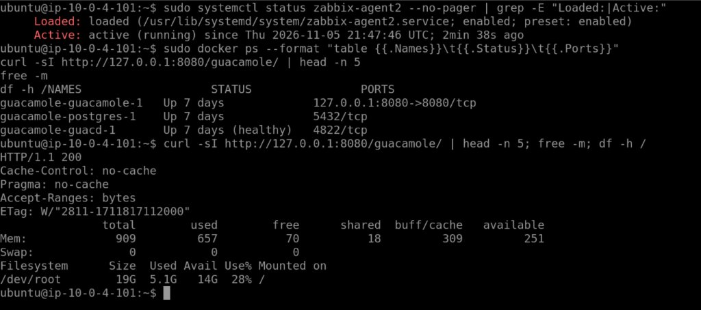
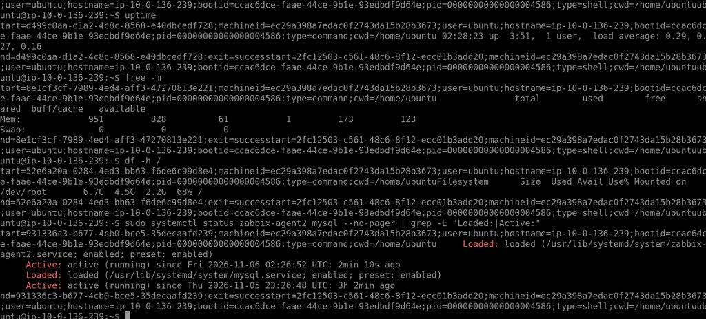
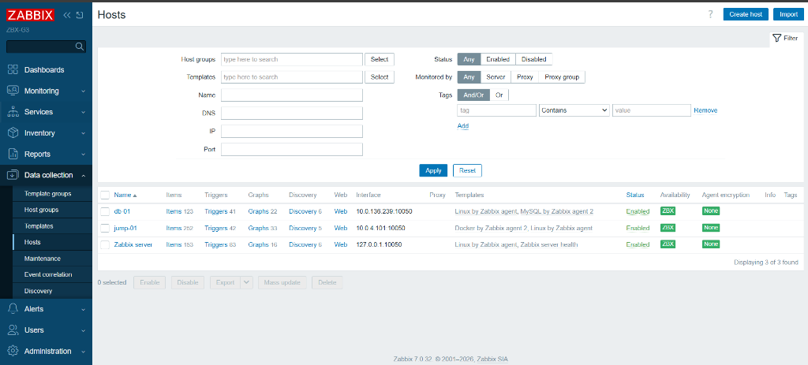
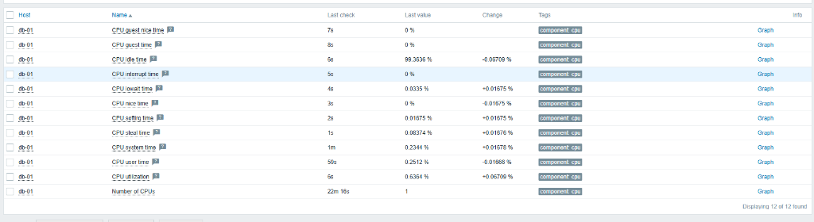
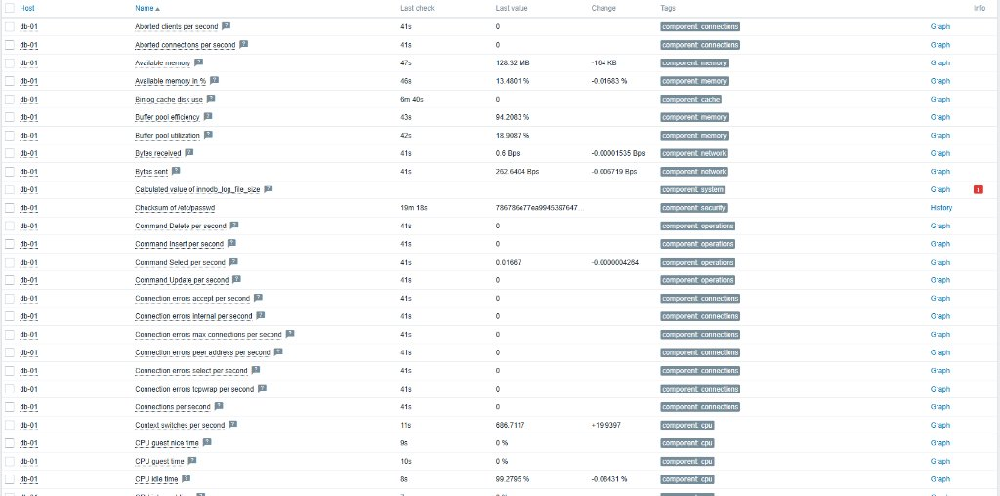
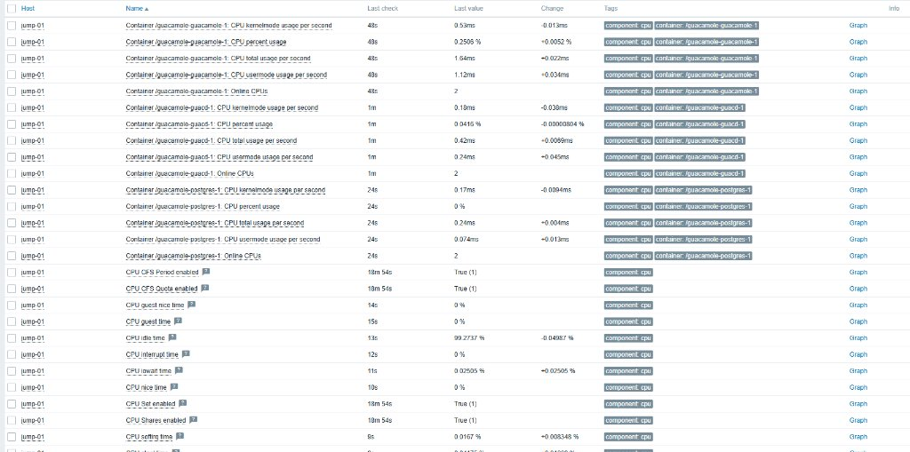
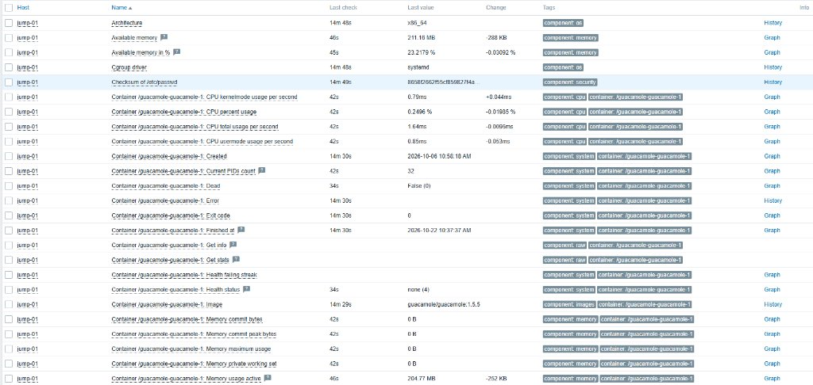

# Documento Técnico de Entrega e Handoff - Roteiro 4 (Zabbix)

**Disciplina:** Cibersegurança em Nuvem  
**Instituição:** Insper Instituto de Ensino e Pesquisa  
**Contexto:** Operação e Gerenciamento com Zabbix 7.0 LTS  
**Grupo G3:**
* **Sidney Barbosa** – Responsável: Tarefa 2 (Banco de Dados & Jump Server)
* **Eduardo** – Responsável: Tarefa 2 (Web Server & Dashboard Integrado)
* **Henrique** – Responsável: Tarefa 1 (Infraestrutura Zabbix/Wazuh, HTTPS & DNS)
* **Gustavo** – Responsável: Tarefa 3 (Triggers, Alertas, Testes e Notificações)
* **Lucas** – Responsável: Tarefa 4 (Análise Comparativa Zabbix vs. Wazuh & Consolidação Final)

---

## Finalidade do Documento

Este documento possui caráter estritamente técnico e operacional. Destina-se a:
1. Registrar formalmente a execução e comprovação visual da **Tarefa 2 (Banco de Dados MySQL e Jump Server Guacamole)**;
2. Disponibilizar as respostas técnicas das questões **T2 Q1** e **T2 Q4** para inserção no relatório final (Lucas);
3. Fornecer o mapeamento de métricas e chaves para a montagem do dashboard integrado (Eduardo);
4. Servir de guia técnico consolidado para a execução da **Tarefa 3**, fornecendo as respostas de **T3 Q1 a T3 Q5**, expressões de triggers e procedimentos de teste (Gustavo).

---

# SEÇÃO 1: Tarefa 2 – Monitoramento do Banco de Dados e Jump Server

## 1.1. Topologia da Infraestrutura Monitorada

| Hostname (Zabbix) | Instância AWS EC2 | IP Privado | Contexto de Rede | Porta | Templates Vinculados |
| :--- | :--- | :--- | :--- | :---: | :--- |
| **`db-01`** | `g3-db-server-instance` (`t2.micro`) | `10.0.136.239` | Sub-rede privada (sem IP público) | `10050/tcp` | • `Linux by Zabbix agent`<br>• `MySQL by Zabbix agent 2` |
| **`jump-01`** | `guacamole` (`t2.micro`) | `10.0.4.101` | Sub-rede pública / Acesso via Guacamole | `10050/tcp` | • `Linux by Zabbix agent`<br>• `Docker by Zabbix agent 2` |
| **`Zabbix server`** | `g3-wazuh-server` (`t3.medium`) | `10.0.4.20` | `https://zabbix.maisplace.net.br` | `10051/tcp` | • `Linux by Zabbix agent`<br>• `Zabbix server health` |

### Procedimentos Técnicos e Hardening Executados:
* **Firewall de Borda (AWS Security Groups):**
  * No Security Group do Banco (`g3-dbserver` / `sg-03adf00c20d9725af`): liberada a porta `10050/tcp` para a rede interna da VPC (`10.0.0.0/16`) e a porta `22/tcp` (SSH) restrita ao Jump Server (`sg-073f913d4abf7b330`).
  * No Security Group do Jump Server (`g3-guacamole` / `sg-073f913d4abf7b330`): liberada a porta `10050/tcp` para a VPC (`10.0.0.0/16`).
  * No Security Group do Zabbix Server (`g3-sc-wazuh` / `sg-037a90ce974392b5e`): liberada a porta `22/tcp` para o Jump Server (`10.0.4.101`).
* **Configuração do Zabbix Agent 2 nos Nós Monitorados:**
  * O arquivo `/etc/zabbix/zabbix_agent2.conf` de ambos os hosts foi configurado com `Server=127.0.0.1,10.0.0.0/16` e `ServerActive=10.0.4.20`, permitindo conexões passivas originadas pelo Zabbix Server.
* **Princípio do Menor Privilégio no MySQL:**
  * O monitoramento do banco foi viabilizado através de um usuário específico (`zbx_monitor`), com permissões restritas a leitura de status (`REPLICATION CLIENT, PROCESS, SHOW DATABASES, SHOW VIEW`), sem concessão de privilégios de leitura de dados de aplicação ou escrita:
    ```sql
    CREATE USER IF NOT EXISTS 'zbx_monitor'@'%' IDENTIFIED BY 'ZbxMonitor@G3_2026';
    GRANT REPLICATION CLIENT, PROCESS, SHOW DATABASES, SHOW VIEW ON *.* TO 'zbx_monitor'@'%';
    FLUSH PRIVILEGES;
    ```
* **Parametrização de Macros no Host `db-01`:**
  * `{$MYSQL.DSN}` = `tcp://10.0.136.239:3306` (endereço de bind do serviço MySQL).
  * `{$MYSQL.USER}` = `zbx_monitor`
  * `{$MYSQL.PASSWORD}` = `ZbxMonitor@G3_2026`

---

## 1.2. Respostas Técnicas da Tarefa 2

### Questão 1 (T2 Q1): Qual é a diferença entre o monitoramento realizado por meio de um agente instalado no servidor e o monitoramento utilizando o protocolo SNMP?

**Resposta:**

A diferença primordial entre o monitoramento baseado em agente nativo (ex.: **Zabbix Agent 2**) e o baseado em **SNMP (*Simple Network Management Protocol*)** concentra-se no modelo arquitetural, no nível de visibilidade sobre o sistema operacional e no transporte dos dados:

1. **Monitoramento Baseado em Agente (`zabbix-agent2`):**
   * **Execução e Visibilidade Interna:** O agente roda como um daemon nativo no espaço de usuário do host monitorado, obtendo acesso direto às interfaces do kernel (`/proc`, `/sys`), descritores de sockets, logs locais e serviços de container (como o socket do Docker em `/var/run/docker.sock`).
   * **Modos de Coleta (Passivo e Ativo):** Além do modelo passivo (*polling* na porta `10050/tcp`), suporta checagens ativas (porta `10051/tcp`), onde o próprio agente coleta e despacha métricas em lote para o servidor Zabbix. Isso reduz a carga no servidor e provê resiliência via buffer local de dados durante interrupções de rede transitórias.
   * **Segurança e Extensibilidade:** Implementa criptografia nativa e autenticação mútua via TLS (PSK ou certificados digitais), além de permitir plugins modulares de alta eficiência compilados em Go (ex.: plugin nativo de MySQL).

2. **Monitoramento via SNMP (v1, v2c, v3):**
   * **Abordagem Universal e *Agentless*:** Projetado originalmente para ativos de infraestrutura de telecomunicação e appliances de rede (roteadores, switches, balanceadores, nobreaks), onde não há suporte à instalação de softwares adicionais.
   * **Estrutura de Dados (MIBs e OIDs):** Opera por meio de variáveis padronizadas estruturadas em árvores MIB (*Management Information Base*) identificadas por OIDs (*Object Identifiers*). A comunicação padrão ocorre sobre UDP (porta `161/udp` para consultas e `162/udp` para *Traps* assíncronas).
   * **Limitações:** As versões v1 e v2c transmitem credenciais (*community strings*) em texto não cifrado. O SNMP v3 provê criptografia (USM), mas demanda maior processamento e carece de suporte nativo para inspeção de containers Docker ou consultas analíticas em bancos de dados relacionais, sendo inferior ao agente para servidores Linux em nuvem.

---

### Questão 4 (T2 Q4): Considerando os recursos da organização, quais indicadores o grupo considera mais importantes para acompanhar a disponibilidade e o desempenho do ambiente? Justifique.

**Resposta:**

Na arquitetura implementada na AWS — compreendendo Servidor Web (`web-01`), Banco de Dados (`db-01`), Jump Server (`jump-01`) e Servidor Zabbix/Wazuh —, priorizam-se indicadores estruturados em quatro camadas críticas de observabilidade:

1. **Disponibilidade Efetiva da Aplicação e Dependências de Negócio:**
   * **MySQL (`mysql.ping` e conexões ativas):** A operação do servidor web WordPress depende integralmente do MySQL para autenticação e renderização de conteúdo dinâmico. Um travamento no processo `mysqld` ou esgotamento de conexões disponíveis resulta em indisponibilidade total da aplicação perante o usuário final, mesmo que a máquina EC2 continue respondendo a checagens de ICMP (ping).
   * **Checagem Operacional do Guacamole e Containers Docker:** Monitoramento da resposta HTTP da interface web do Guacamole (`web.page.regexp`) e integridade dos containers (`guacamole`, `guacd`, `postgres`). Por determinação de segurança do Roteiro 2, o acesso SSH direto da internet foi revogado; o Guacamole constitui o **único canal administrativo** para as instâncias da rede privada.
   * **Processos e Porta HTTP do Servidor Web:** Checagem da porta `80/443` (`net.tcp.service[http]`) e execução dos processos do Apache.

2. **Memória RAM Disponível e Comportamento de Swap (`vm.memory.available`, `system.swap.size[,pused]`):**
   * Instâncias em nuvem com perfis enxutos (`t2.micro` e `t3.medium`) operam próximas da saturação de memória. O esgotamento de RAM disponível provoca a intervenção do *OOM Killer* (*Out-Of-Memory Killer*) do kernel Linux, que finaliza abruptamente processos pesados (como `mysqld`, `wazuh-indexer` ou Java/Guacamole) para prevenir *kernel panic*. O acompanhamento preventivo da memória disponível evita paradas de serviço não programadas.

3. **Capacidade de Armazenamento e Inodes em Disco (`vfs.fs.dependent.size[/,pfree]`):**
   * O preenchimento da partição raiz (`/`) por logs de auditoria, binlogs do banco ou índices de segurança bloqueia operações de escrita temporária, interrompe transações do MySQL, impede a abertura de sessões administrativas e pode ocasionar corrupção de dados.

4. **Saturação de CPU, *I/O Wait* e Tráfego de Rede (`system.cpu.util`, `system.cpu.util[,iowait]`, `net.if.in/out`):**
   * Indicadores vitais para diferenciar problemas de capacidade operacional de incidentes de segurança cibernética: picos contínuos de CPU aliados a anomalias de rede podem denunciar ataques de negação de serviço (DoS/DDoS) ou infecção por malware de mineração criptográfica (*cryptojacking*), enquanto elevações de *iowait* apontam saturação de taxa de IOPS no volume EBS.

---

## 1.3. Relação de Indicadores para o Dashboard do Eduardo

Tabela para configuração dos widgets no Dashboard integrado do grupo:

| Host (Alvo) | Grupo Zabbix | Indicador | Chave do Item (*Key*) | Tipo de Widget Recomendado |
| :--- | :--- | :--- | :--- | :--- |
| **`db-01`** | `Database servers` | Disponibilidade do Agente (ZBX) | `zabbix[host,agent,available]` | *Host availability* |
| **`db-01`** | `Database servers` | Status Operacional do MySQL | `mysql.ping` | *Item value* (1 = Up) |
| **`db-01`** | `Database servers` | Eficiência do Buffer Pool (%) | `mysql.buffer_pool_efficiency` | *Gauge* |
| **`db-01`** | `Database servers` | Consultas Select por segundo | `mysql.queries.select.rate` | *Graph* (Série temporal) |
| **`db-01`** | `Database servers` | Utilização de CPU (%) | `system.cpu.util` | *Gauge* ou *Graph* |
| **`db-01`** | `Database servers` | Memória RAM Disponível (MB) | `vm.memory.available` | *Single Item Value* |
| **`jump-01`** | `Linux servers` | Disponibilidade do Agente (ZBX) | `zabbix[host,agent,available]` | *Host availability* |
| **`jump-01`** | `Linux servers` | Aplicação Web Guacamole (HTTP) | `web.page.regexp[127.0.0.1,/guacamole/,8080,"Guacamole",]` | *Item value* |
| **`jump-01`** | `Linux servers` | Status dos Containers Docker | `docker.container_info[...]` | *Table* / *Status Badge* |
| **`jump-01`** | `Linux servers` | Utilização de CPU e RAM (%) | `system.cpu.util` / `vm.memory.utilization` | *Graph* |
| **`jump-01`** | `Linux servers` | Espaço Livre em Disco `/` (%) | `vfs.fs.dependent.size[/,pfree]` | *Progress Bar* / *Gauge* |

---

## 1.4. Registro de Evidências Visuais (Prints 1 a 7)

Todos os arquivos de imagem encontram-se salvos no diretório local `Roteiro 4/evidencias/`:

### Print 1: Instalação e Estado Operacional do Jump Server
* **Arquivo:** `evidencias/01_jump_terminal_agente_e_estado.png`
* **Descrição:** Terminal do Jump Server (`ubuntu@ip-10-0-4-101`) evidenciando o `zabbix-agent2` ativo (`active (running)`), containers Docker do Guacamole em execução (`Up 7 days`), resposta `HTTP/1.1 200 OK` na porta local `8080/guacamole/`, e parâmetros de memória (`free -m`) e partição raiz (`df -h /`).



---

### Print 2: Instalação e Estado Operacional do Servidor de Banco de Dados
* **Arquivo:** `evidencias/02_db_terminal_agente_mysql_e_estado.png`
* **Descrição:** Terminal do Servidor de Banco de Dados (`ubuntu@ip-10-0-136-239`) demonstrando os serviços `zabbix-agent2.service` e `mysql.service` ativos (`active (running)`), juntamente com a memória disponível (`free -m`: 123 MB), partição raiz (`df -h /`: 68% de ocupação) e tempo de atividade da máquina (uptime 3h51).



---

### Print 3: Hosts Cadastrados e Conectados com Sucesso no Zabbix Web
* **Arquivo:** `evidencias/03_zabbix_hosts_cadastrados_ativos.png`
* **Descrição:** Interface do Zabbix 7.0 LTS (**Data collection > Hosts**) comprovando o registro de `db-01` (`10.0.136.239:10050`), `jump-01` (`10.0.4.101:10050`) e `Zabbix server` (`127.0.0.1:10050`), todos com status `Enabled` e disponibilidade **`ZBX` em verde**, confirmando o roteamento e liberação de portas nos Security Groups.



---

### Print 4: Coleta de Recursos de Sistema Operacional do Banco de Dados
* **Arquivo:** `evidencias/04_db01_latest_data_recursos.png`
* **Descrição:** Visão de dados recentes (**Monitoring > Latest data** filtrado por `db-01`) demonstrando a coleta periódica de métricas de CPU: utilização total (`0.6364 %`), tempo ocioso (`99.36 %`), CPU iowait, CPU system e 1 vCPU atribuída.



---

### Print 5: Coleta de Métricas Operacionais do MySQL
* **Arquivo:** `evidencias/05_db01_mysql_disponibilidade_e_metricas.png`
* **Descrição:** Telemetria obtida via plugin nativo do MySQL no host `db-01`: eficiência do buffer pool (`94.20 %`), utilização do buffer pool (`18.90 %`), taxa de consultas de leitura (`Command Select: 0.01667/s`), tráfego de rede gerado pelo banco e métricas de memória.



---

### Print 6: Coleta de Recursos de Sistema Operacional do Jump Server
* **Arquivo:** `evidencias/06_jump01_latest_data_recursos.png`
* **Descrição:** Painel de dados recentes (**Monitoring > Latest data** filtrado por `jump-01`) exibindo a coleta de uso de CPU do sistema operacional (`CPU idle: 99.27 %`), combinada às métricas de consumo de processamento dos containers Docker em execução simultânea.



---

### Print 7: Monitoramento de Containers Docker do Guacamole no Jump Server
* **Arquivo:** `evidencias/07_jump01_guacamole_checagem_operacional_e_docker.png`
* **Descrição:** Telemetria via `Docker by Zabbix agent 2` no host `jump-01`, comprovando a descoberta e monitoramento em tempo real do container `/guacamole-guacamole-1`: utilização de CPU (`0.2496 %`), memória ativa (`204.77 MB`), contagem de descritores (`32 PIDs`) e integridade de execução (`Exit code: 0`).



---
---

# SEÇÃO 2: Material de Apoio Técnico para a Tarefa 3 (Para o Gustavo)

Este material consolida as definições teóricas, a tabela técnica justificada e o roteiro operacional para a implementação de alertas e testes de estresse da Tarefa 3.

---

## 2.1. Tabela Técnica de Triggers Justificadas

| Categoria | Indicador (*Item*) | Expressão da Trigger (*Trigger Expression*) | Severidade | Justificativa do Limite Técnico | Condição de Recuperação (*OK Event*) |
| :--- | :--- | :--- | :---: | :--- | :--- |
| **Serviço** | `mysql.ping` no `db-01` ou `net.tcp.service[http]` no `web-01` | `last(/db-01/mysql.ping)=0` | **High** | A indisponibilidade do banco de dados interrompe a execução do WordPress e quebra o serviço final aos usuários. | O item voltar a responder `1` (`last()=1`). |
| **CPU** | `system.cpu.util` no `db-01` | `min(/db-01/system.cpu.util,3m) > 80` | **Warning** | Picos breves são transitórios e normais; contudo, uso sustentado acima de 80% por 3 minutos indica saturação severa ou travamento de processo. | A média de utilização recuar para `<= 80%`. |
| **Disco** | `vfs.fs.dependent.size[/,pfree]` | `last(/db-01/vfs.fs.dependent.size[/,pfree]) < 20` | **Warning** | Menos de 20% de espaço livre em `/` inviabiliza gravações de logs e arquivos temporários, com risco de corrupção de tabelas do MySQL. | O percentual de espaço livre voltar a ser `>= 20%`. |

---

## 2.2. Respostas Teóricas da Tarefa 3

### Questão 1 (T3 Q1): Explique a diferença entre um indicador (item) e uma condição de alerta (trigger) no Zabbix.

**Resposta:**  
O **indicador (*Item*)** representa o registro numérico ou textual bruto de uma métrica coletada periodicamente (ex.: utilização percentual de processamento, espaço livre em disco, código de status HTTP). Ele apenas armazena e quantifica o estado do recurso ao longo do tempo, de maneira neutra e descritiva.  
A **condição de alerta (*Trigger*)** consiste em uma expressão lógica configurada sobre os valores coletados de um ou mais itens. Sua função é avaliar continuamente se o estado do sistema transgride parâmetros predefinidos de normalidade. Caso a condição seja verdadeira, a trigger comuta para o estado **`PROBLEM`**, gerando um evento na plataforma e habilitando o disparo de ações de notificação ou remediação automática.

---

### Questão 2 (T3 Q2): Discuta os riscos associados à definição de limites muito sensíveis ou pouco sensíveis para alertas. Como isso impacta a equipe de operações?

**Resposta:**  
* **Limiares Excessivamente Sensíveis:** Geram elevado volume de notificações decorrentes de variações normais de operação (falsos positivos). Essa saturação culmina no fenômeno de **fadiga de alertas (*alert fatigue*)**, no qual a equipe desenvolve dessensibilização psicológica, negligenciando notificações críticas reais encobertas pelo ruído excessivo.
* **Limiares Pouco Sensíveis:** Provocam **falsos negativos**, impedindo que a equipe identifique degradações progressivas de serviço (ex.: saturação gradativa de memória ou preenchimento contínuo de partição). A intervenção só ocorre de forma reativa após o colapso completo da infraestrutura.

---

### Questão 3 (T3 Q3): Qual é a importância de monitorar a recuperação de um serviço após a ocorrência de um alerta?

**Resposta:**  
O monitoramento do retorno ao estado de normalidade (*Recovery Event*) é fundamental para:
1. **Fechamento do Ciclo do Incidente:** Valida de forma automatizada que a ação corretiva aplicada restaurou os parâmetros operacionais esperados.
2. **Cálculo de Confiabilidade e Conformidade (SLA):** Permite mensurar a duração exata da degradação, viabilizando o cálculo do **MTTR (*Mean Time To Repair*)** e a prestação de contas contratual.
3. **Eficiência Operacional:** Comunica imediatamente a equipe técnica sobre a resolução do incidente, desmobilizando operadores e prevenindo duplicidade de esforços de atendimento.

---

### Questão 4 (T3 Q4): Toda condição que gera um alerta indica necessariamente um incidente de segurança? Justifique com exemplos.

**Resposta:**  
**Não.** A maior parte dos alertas operacionais decorre de eventos rotineiros de infraestrutura ou falhas de software sem implicação de cibersegurança (ex.: pico de CPU durante compactação de backups, preenchimento de disco por rotação inadequada de logs ou indisponibilidade temporária de serviço durante aplicação de patches).  
No entanto, métricas de infraestrutura podem constituir o **primeiro indicador de comprometimento (IoC)** de um ataque cibernético:
* Elevação sustentada de **CPU a 100%** pode resultar de infecção por malware de mineração de criptomoedas (*cryptojacking*) ou de um ataque de negação de serviço (DoS/DDoS).
* Preenchimento abrupto de **disco ou memória** pode ser consequência de ataques de força bruta massivos gerando gigabytes de logs ou de execução de *ransomware* cifrando partições e gerando arquivos temporários.

---

### Questão 5 (T3 Q5): Quais são as consequências para a organização quando alertas de monitoramento são gerados, mas não há processos definidos para tratamento e resposta?

**Resposta:**  
A emissão de alertas sem procedimentos formais de resposta cria uma ilusão ineficaz de segurança e controle. As principais consequências envolvem:
* **Extensão do Tempo de Reparo (MTTR):** A ausência de playbooks ou procedimentos operacionais padrão (POPs) gera indefinição técnica e atrasa o restabelecimento do serviço.
* **Indefinição de Responsabilidade:** Alertas emitidos sem matriz de escalonamento clara não são assumidos por nenhum operador (*efeito espectador*), permanecendo sem tratamento.
* **Prejuízos Financeiros e Riscos de Conformidade:** Interrupção de receitas em aplicações comerciais, quebra de contratos de nível de serviço (SLAs) e descumprimento de prazos regulatórios de contenção e reporte de incidentes (ex.: LGPD/GDPR).

---

## 2.3. Roteiro Prático de Configuração e Testes para a Tarefa 3

### Etapa 1: Configuração do Meio de Notificação (E-mail)
1. No Zabbix Web, acessar **Alerts > Media types > Email**.
2. Parametrizar o servidor SMTP (ex.: Gmail em `smtp.gmail.com:587`, STARTTLS, usuário e senha de aplicativo).
3. Efetuar o teste de envio na linha do e-mail (**Print 1 da Tarefa 3**).
4. Vincular o e-mail em **Users > Users > Admin** (aba **Media**).
5. Criar a regra em **Alerts > Actions > Trigger actions** para notificar tanto em *Operations* (Problem) quanto em *Recovery operations* (Resolved) (**Print 2 da Tarefa 3**).

### Etapa 2: Configuração das Triggers
1. Cadastrar as 3 triggers descritas na tabela no host `db-01` ou `web-01`.
2. Registrar a lista de triggers ativas (**Print 3 da Tarefa 3**) e o formulário detalhado de configuração (**Print 4 da Tarefa 3**).

### Etapa 3: Execução das Simulações de Carga e Indisponibilidade
1. **Simulação 1 – Parada de Serviço:**
   * No servidor de banco de dados (`10.0.136.239`), executar: `sudo systemctl stop mysql`.
   * Registrar o evento em vermelho em **Monitoring > Problems** (**Prints 5 e 6 da Tarefa 3**).
   * Coletar o print da notificação recebida por e-mail (**Print 7 da Tarefa 3**).
   * Restaurar o serviço: `sudo systemctl start mysql`.
   * Registrar a normalização para o status **RESOLVED** (**Print 8 da Tarefa 3**).
2. **Simulação 2 – Sobrecarga de Processamento:**
   * No servidor monitorado, instalar o gerador de carga: `sudo apt install -y stress`.
   * Executar estresse em 2 núcleos por 4 minutos: `stress --cpu 2 --timeout 240s` (**Print 9 da Tarefa 3**).
   * Registrar o disparo do alarme de CPU no Zabbix Web, aguardar o término do comando e capturar o retorno a **RESOLVED** juntamente com o gráfico de pico de utilização (**Print 10 da Tarefa 3**).
